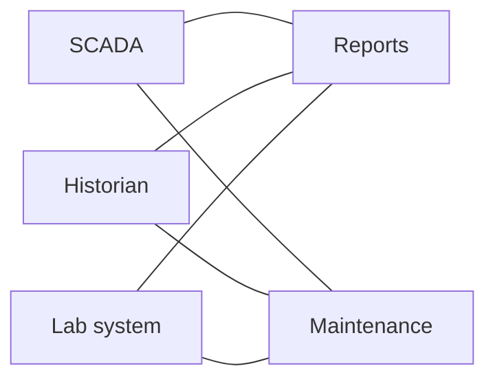
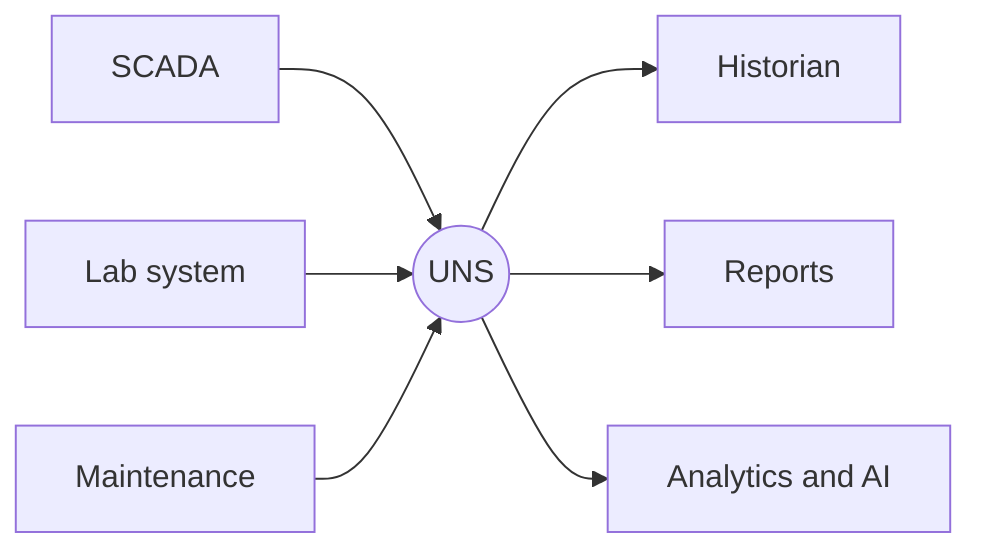
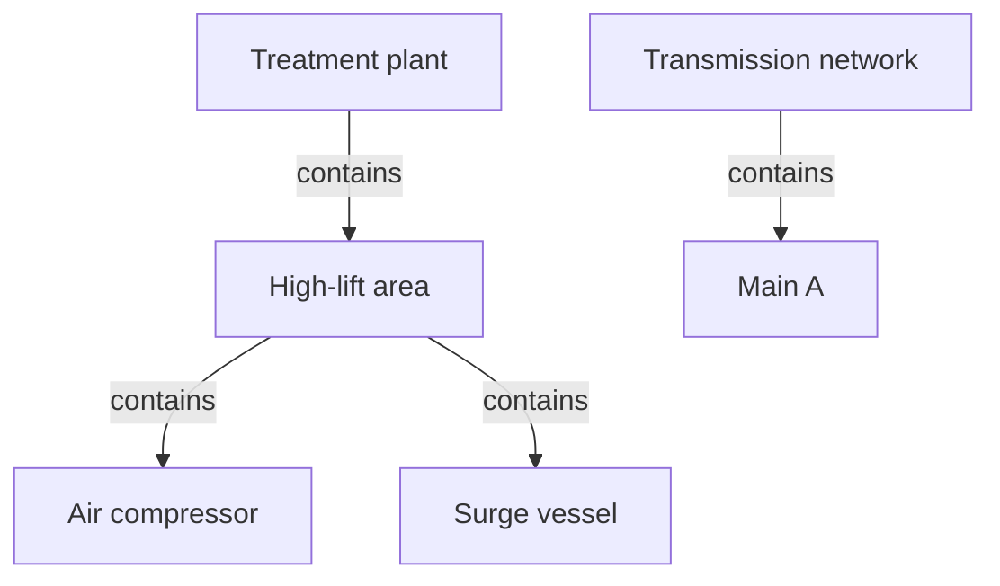
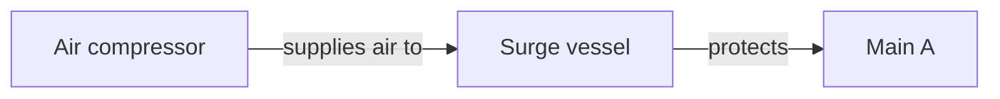
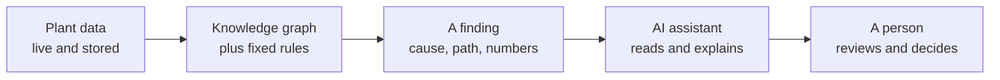

# 1. The ideas

*About 3 minutes. Unfamiliar terms are explained in the [glossary](optional/references.md#glossary).*

Plants already have data. What software and AI lack is **meaning**: what each value belongs to, and how one piece
of equipment affects another. This page explains how that meaning is built up.

## Why a utility would bother

The aim is practical. When the meaning is written down once, three things get easier:

- **Finding the cause** of an incident, instead of working through a flood of alarms.
- **Trusting a number**, because it has one name and one source.
- **Adding a new tool**, without rebuilding every connection to it.

## The problem: every system wired to every other

Most plants grew one system at a time. Each new system was connected directly to the ones it needed.

Three things follow. Every link is custom work. Calculations end up locked inside the reports that use them.
And the same value has a different name in each system, so there is **no single source of truth**.

A Unified Namespace (UNS) addresses the wiring. It is an architecture, not a product: every system publishes
its data to one shared place, in one agreed structure, and reads from it. The structure usually borrows the
equipment hierarchy of the ISA-95 standard, often shortened to site, area, equipment.

That is a big step, and it is not the whole answer. A UNS shares the current values. Asking a question of
stored data, or sending a command, still needs other means. The rest of this page explains what else it lacks.

## Three terms, one step at a time

| Term | In plain words | Water example |
|---|---|---|
| **Graph** | Things, and lines between them. The lines mean nothing in particular. | "Compressor — Surge vessel — Main" |
| **Knowledge graph** | Every thing has a *type*, and every line has a *named meaning*. | The compressor **supplies air to** the surge vessel. The surge vessel **protects** the main. |
| **Knowledge model** | The rule book: which types exist, what properties they have, and which connections are allowed. | "A surge vessel is a kind of equipment. *Protects* may only join one part of the plant to another, never to a document." |

Each one builds on the one before. The knowledge graph is *derived* from the knowledge model, not drawn by
hand. The formal name for a knowledge model is an **ontology**; you will meet both words.

A helpful picture, from Kudzai Manditereza: the knowledge model is the **blueprint**, and the knowledge graph
is the **house** built from it at a real address.

## UNS and knowledge graph: you need both

A UNS organises live data into one tree. That tree is a graph with **one** relationship: *contains*.

The same three pieces of equipment, seen both ways:

**The UNS is a tree. It tells you where.**

**The knowledge graph is a web. It tells you why.**

In the tree, the compressor and the main look unrelated: they sit in different branches. In the knowledge
graph, one path joins them. That path is how software works out that a compressor fault can end in a broken
main.

They are complementary. The UNS carries the live values. The knowledge graph tells you what those values mean
together. One way to put it: the UNS answers *what is the value now?*, and the knowledge graph answers *what does it
belong to, and what does it affect?*

As most teams build it, a UNS holds only the **latest** value, and the history is stored somewhere else:
see [Where the history goes](optional/where-the-history-goes.md). Some people use "UNS" for the whole
architecture, history included. This repository uses the narrower meaning.

When both are generated from the **same model**, they stay in step. That is the pattern this repository
teaches.

## How AI uses the graph

An AI assistant should not be handed a pile of raw tags and asked to guess. The knowledge graph sits in between.

- **The assistant asks through an open API** ([page 3](3-an-open-api.md)) and receives only the part of the
  graph that matters to the question.
- **What it is given** is types, relationships and computed results, each traceable to its source. It reads
  the result. It does not decide it.

None of these ideas is original here. [Where they come from](optional/references.md#where-the-ideas-come-from).

Next: [What a model looks like](2-what-a-model-looks-like.md).
