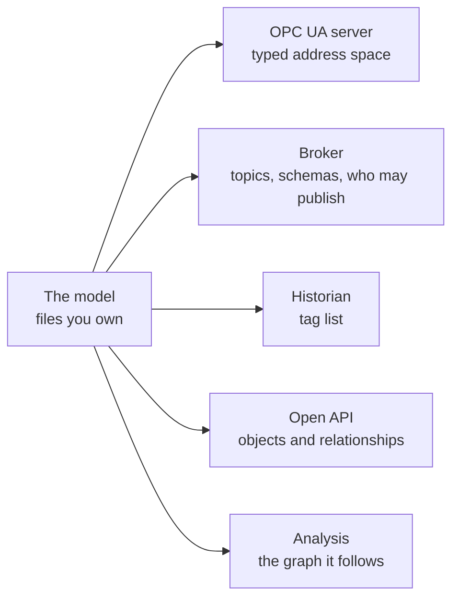

# 2. What a model looks like

*About 5 minutes. Unfamiliar terms are explained in the [glossary](optional/references.md#glossary).*

A model is a few text files. People can read them, review them and keep them in version control.

There are three examples, all invented:

- [starter-model.yaml](../examples/starter-model.yaml): one file of about 40 lines. **Start here.** Copy it and
  replace the names with your own.
- [example-plant/](../examples/example-plant/): a fuller drinking-water model of 18 assets (nine of them
  equipment), in three files. It shows where a starter model grows to.
- [example-wastewater/](../examples/example-wastewater/): a wastewater model that reuses the same types and
  adds a few of its own.

YAML is used here because it is easy to read. The same model could be a spreadsheet, a JSON file, or held in a
modelling tool. The format matters less than having one reviewed model.

## Three files, three owners

The fuller example is split by the question each file answers.

| File | The question it answers | Who would own it | How often it changes |
|---|---|---|---|
| [1-types.yaml](../examples/example-plant/1-types.yaml) | What kinds of things can exist? | A cross-department standards group | Rarely |
| [2-plant.yaml](../examples/example-plant/2-plant.yaml) | What do we have, and how is it connected? | Asset management, with operations | When the plant changes |
| [3-bindings.yaml](../examples/example-plant/3-bindings.yaml) | Where does each value live in each system? | The automation or SCADA group | When a system or a tag changes |

The split makes the model easier to govern. Each file has one owner and one kind of review. Replacing a
historian touches only the third file. Adding a pump never touches the first: it goes in the second, and its
addresses in the third.

### Who owns what

In most utilities each department already looks after its own data. A shared model does not take that away.
It adds a few things that someone must own across departments. One workable split:

| Part | Who is accountable | Why |
|---|---|---|
| Types and standards | A small cross-department group, with a neutral chair such as asset management | Shared definitions need an enterprise view |
| Asset identity and hierarchy | Asset management | It already keeps the asset register |
| Relationships, and what each measurement means | Operations and process staff in each department | They know how the plant really connects |
| Addresses, topics and the running namespace | The automation or SCADA group | It touches controllers and the control network |
| Servers, hosting, backup and monitoring | A data or infrastructure group, as a platform service | Keeps the platform apart from the meaning |
| Review of every connection | Security | Independent of the people who build |
| Priorities and disputes | A governance group with a senior sponsor | Someone must be able to decide |

Two rules hold it together. **One role is accountable for the namespace as a whole,** so that several owners
do not become none. And **the group that runs the platform does not own the meaning:** it provides the
service, and the departments decide what the data says.
([More on ownership](optional/keeping-the-model-honest.md#choosing-the-overall-owner).)

The idea of keeping types, data sources and transport apart comes from "model as code" practice
([credit](optional/references.md#where-the-ideas-come-from)). The excerpts below are shortened from the three files.

## File 1: the types

```yaml
types:
  Pump:        {extends: Equipment, description: "A pump position"}
  SurgeVessel: {extends: Equipment, description: "An air-cushioned surge vessel on a pump discharge"}
  Main:        {extends: Equipment, description: "A section of transmission main"}
```

Start here. "What is a pump? What is a reservoir?" Once a type is defined, every pump follows it.

`extends` means inheritance: a pump is a kind of equipment, so it gets everything equipment has and can add
its own. A type can also say what every member must have. In the example, every pump must have a run state
and a trip alarm, and a pump without them fails the check.

**Reuse before you invent.** Most of these types are written from scratch to keep the example short, and each
one records the standard it follows or should have been checked against. In practice,
check first whether a published standard already defines the type. Pumps are one case: the OPC Foundation
publishes an [OPC UA specification for pumps](https://reference.opcfoundation.org/Pumps/v100/docs/) (OPC 40223).
[More places to look](optional/references.md#where-to-find-ready-made-types).

## File 2: the plant

**Assets** are the things you actually have. `parent` gives the familiar tree: site, area, equipment.

```yaml
assets:
  EXAMPLE_WTP:  {type: Site, displayName: Example Water Treatment Plant}
  HIGH_LIFT:    {type: Area, displayName: Clearwell and high lift, parent: EXAMPLE_WTP}
  SURGE_VESSEL: {type: SurgeVessel, displayName: Discharge surge vessel, parent: HIGH_LIFT}
```

**Measurements** give each value one owner, one type and one unit.

```yaml
measurements:
  MAIN_A_PRESSURE: {asset: MAIN_A, type: Pressure, unit: kPa}
```

**Relationships** say how things affect each other. This is the part a tag list never had.

```yaml
relationships:
  - {source: AIR_COMPRESSOR, type: SuppliesAir, target: SURGE_VESSEL}
  - {source: SURGE_VESSEL,   type: Protects,    target: MAIN_A}
  - {source: HLP_01,         type: Feeds,       target: MAIN_A}
```

Each line is a plain sentence: the compressor supplies air to the surge vessel; the surge vessel protects the main.
Together they are the knowledge graph.

**Records** link equipment to its documents: the procedure that governs it, the drawing it appears on. The
model holds a pointer to each record and the facts that matter here (a drawing's revision, a work order's
status), never the document itself.

## File 3: the bindings

```yaml
measurements:
  MAIN_A_PRESSURE:
    opcua:     {identifier: TxA.MainA.Pressure}
    historian: {tag: TX_A.MAIN_A.PRESSURE}
    mqtt:      {topic: example/telemetry/water/TX_A/MAINS_A/MAIN_A/PRESSURE}
```

The same value, with its address in each system side by side: the controller, the historian and the broker.
Nobody has to keep three spreadsheets in step. Nothing in the first two files changes when an address does.

This file also says where each record lives, and what each asset is called in other systems, such as its
equipment number in the maintenance system. That mapping is what joins a work order to the right pump.

## What gets generated from it



A small program, often called a model compiler, can read the model and write the configuration for every tool. Nothing is typed
twice. This repository does not include one: [One value, followed through](optional/one-value-followed-through.md)
shows what one would write for a single value.

Three things to remember:

- **The model is checked before anything is generated,** and a change is reviewed by a person
  ([how](optional/keeping-the-model-honest.md#reviewing-changes)).
- **The broker's rules can come from the model.** Once they are generated from it, a message that is not in
  the model is refused.
- **How you write the model is your choice; what you generate should follow standards** wherever one exists
  ([which ones](optional/one-value-followed-through.md#standards-your-outputs-can-follow)).

Next: [An open API](3-an-open-api.md).
