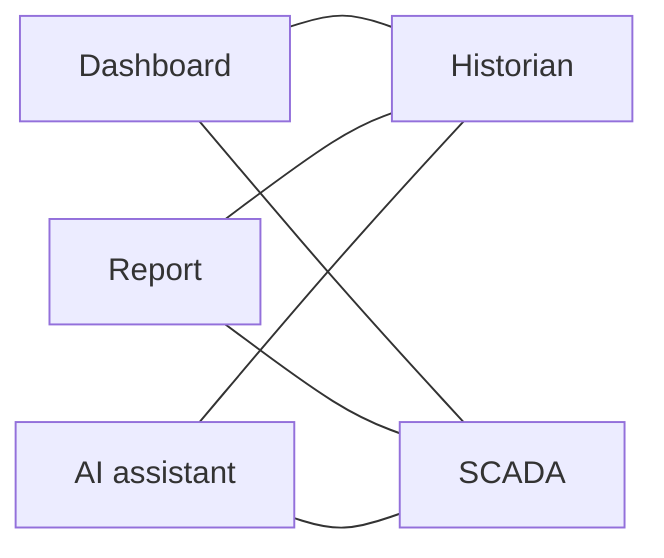
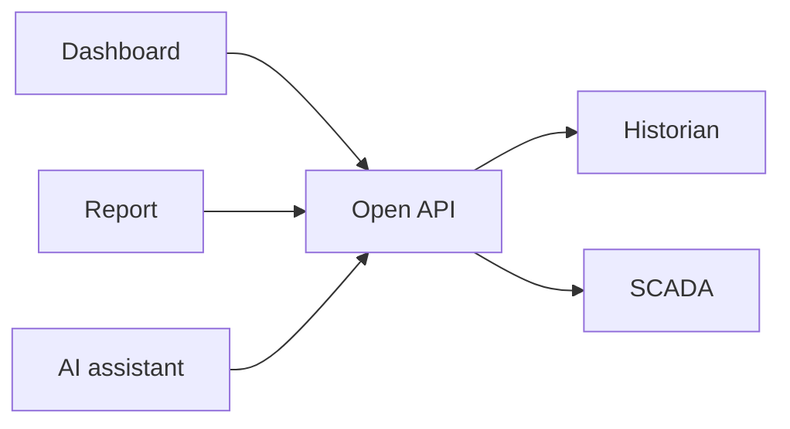

# 3. An open API

*About 3 minutes. Facts on this page were checked against the linked sources in October 2026.*

## The idea

Once your equipment and its relationships are written down, other tools need a way to ask about them. An
**open API** is a published, shared way of asking, which no single vendor owns.

It lets any application ask an industrial system *what things exist, how they relate, and what their values
are and were*.

The example used here is **i3X** (Industrial Information Interoperability eXchange), an open specification led
by [CESMII](https://www.cesmii.org/), the Smart Manufacturing Institute. The idea matters more than the
particular specification.

## The problem an open API addresses

Today each historian, SCADA system and data platform has its own interface. An application written for one
does not work with another.

**Without a common API, every pair needs its own connection.**

**With a common API, there is one way to ask.**

## What an application can ask

These are the kinds of question i3X defines. Any open API for this purpose needs something similar.

| Capability | The question it answers |
|---|---|
| Object types | What kinds of things exist? |
| Objects | Which actual things are there? |
| Relationships | How are they connected, in the hierarchy and across it? |
| Current values | What is the value right now? |
| History | What was it over this period? |
| Subscriptions | Tell me when it changes. |

The example model was laid out to match these
([how the three files line up](optional/one-value-followed-through.md#how-the-three-files-line-up-with-an-open-api)).

## Why an open API matters

- **Less lock-in.** You can change the product underneath without rewriting what sits on top.
- **Portable work.** A tool proven at one site can be reused at another.
- **AI that can find its own way.** An assistant can discover types and relationships through the API,
  instead of being hand-fed tag names.

It does not replace what you have. OPC UA and MQTT move the data. An API like this is how applications ask
questions of it.

## Two things to keep in mind

- **i3X is new.** Version 1.0 was released in June 2026
  ([announcement](https://www.automation.com/article/cesmii-i3x-1.0-open-api-specification-manufacturing-interoperability)).
  Adoption is at an early stage. If a vendor says they support it, ask whether their product passes the
  published conformance tests.
- **It is not the only route to a standard model.**
  [OPC UA companion specifications](https://opcfoundation.org/about/opc-technologies/opc-ua/ua-companion-specifications/)
  define standard models for particular kinds of equipment, and have done for longer.

Whichever route you take, the lesson is the same: build your model with **types and relationships**. A flat
list of tags gives any API very little to serve.

More: [i3x.dev](https://www.i3x.dev/) and the [specification](https://github.com/cesmii/i3X).

Next: [How to get started](4-how-to-get-started.md).
