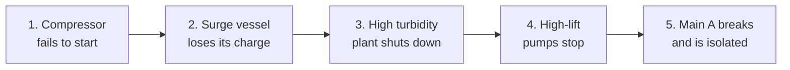
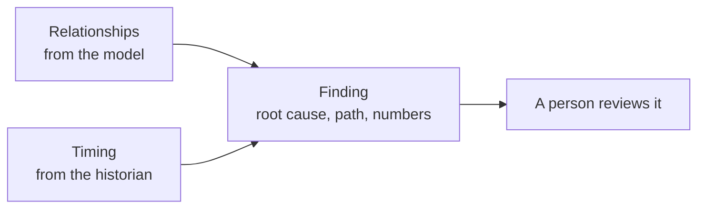

# An incident, followed through the graph

*Optional. About 4 minutes.*

The central claim of this repository is that a model with typed relationships lets software work out **why**
something happened. This page follows one invented incident through the water example to show how.

It is a worked example on paper. Nothing here was run on a real system.

## The incident, step by step

The names are the invented ones from [the water example](../../examples/example-plant/).

1. **The air compressor fails to start.** A work order from two weeks earlier already notes that its breaker
   was found tripped.
2. **The surge vessel loses its air charge.** Surge protection is now unavailable. Nothing else looks wrong yet.
3. **A filter alarms on high turbidity** and the plant shuts down.
4. **The high-lift pumps stop.** The sudden stop sends a pressure wave down the main.
5. **Main A breaks,** because the vessel that should have absorbed the wave could not. The main is isolated.

To the operator this is a flood of alarms from five places within a few minutes.

## How the answer is worked out

An analysis built on the model can do three things, all with fixed rules.

1. **It follows the relationships.** The model says the compressor *supplies air to* the surge vessel and the surge vessel
   *protects* Main A. That path links the first small alarm to the final failure.
2. **It checks the timing.** From the stored history it reads when each event happened, and works out the
   time between the pump stop, the break and the isolation.
3. **It writes a finding.** The finding names the root cause, lists the path, and shows every number with the
   stored value it came from.

Related alarms can be grouped while every underlying event remains available. Suppression requires separately
approved conditions, activation and release rules, and an audit trail.

Because the rules are fixed, the same data always gives the same finding.

See also: [Root cause and anomaly detection, without guessing](root-cause-and-anomaly-detection.md), on how to build this.

## Where AI fits

AI is deliberately absent from the result. The model and the graph make the answer something that can be
worked out by rule. An AI assistant can then *read* the finding and explain it, instead of guessing at the cause.

## A note on security

This repository is **not security guidance**. A water system is critical infrastructure, and connecting plant
data to anything else is a security decision.

- **Involve your security team before you connect anything.**
- Having the plant open the only connection outward is a common pattern. It is not, on its own, a security
  control.
- The [ISA/IEC 62443](https://www.isa.org/standards-and-publications/isa-standards/isa-iec-62443-series-of-standards)
  series is the usual starting point for industrial systems, alongside your own organisation's policies.

Next: [One value, followed through](one-value-followed-through.md).
