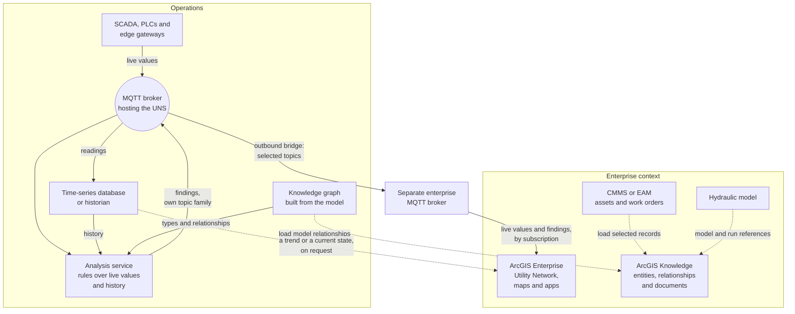

# Digital Twin 3.0: where a data model sits beside a GIS and a maintenance system

*Optional. About 9 minutes. An illustration, not a case study.*

This page considers a hypothetical utility with an enterprise GIS and a maintenance system. It uses three numbered
stages, ending at "Digital Twin 3.0", as an informal teaching framework, then explains what a digital twin means in
the water sector and to Esri, and how the model, the Unified Namespace and the knowledge graph from this repository
could sit beside a GIS such as Esri's ArcGIS and a maintenance system such as IBM Maximo. In this picture each
system stays the record of what it already holds. The model would reference their identifiers and add what affects
what.

## Three stages, in plain words

Here, "Digital Twin 1.0", "2.0" and "3.0" are this page's informal teaching labels, not a standard or an agreed
sequence. The three stages below describe this page's framework:

| Stage | What it adds | What it looks like in a utility |
|---|---|---|
| **Digital Twin 1.0** a static copy | Geometry and attributes: drawings, GIS, a building model | The network in the GIS, the plant in drawings |
| **Digital Twin 2.0** a connected copy | Live values joined to the copy: SCADA, a historian, a UNS, dashboards | A map that colours a pump by its running state |
| **Digital Twin 3.0** a copy that reasons, by fixed rules | Explicit meaning and relationships, so software can propose and explain candidate causes for a person to review | "A compressor fault may have contributed to the loss of surge protection", offered for a person to review, with the path and the numbers |

The pieces this repository teaches are the third stage's foundation: types and relationships
([the ideas](../1-the-ideas.md)), fixed rules over them ([root cause](root-cause-and-anomaly-detection.md)), and an
open way to ask ([an open API](../3-an-open-api.md)). A finding names candidates, not confirmed causes
([candidates are not causes](root-cause-and-anomaly-detection.md#candidates-are-not-causes)). The UNS carries
current values; the knowledge graph describes what they belong to and how things relate
([you need both](../1-the-ideas.md#uns-and-knowledge-graph-you-need-both)).

This repository leaves out commands to equipment
([what this does not cover](../../README.md#what-this-does-not-cover)) and AI that makes the decision
([where AI fits](an-incident-followed-through.md#where-ai-fits)). Here, a finding is worked out by rules a person can
read. Reproducing it later depends on keeping its inputs, the versions of the model and the rules, their
configuration and the starting state ([root cause](root-cause-and-anomaly-detection.md)).

## What a digital twin means, in the water sector and to Esri

One water-sector definition comes from the Digital Twin Work Group behind the SWAN Digital Twin Readiness Guide,
with the SWAN Digital Twin Utility Advisory Group and the American Water Works Association Digital Twins Committee:
**"a dynamic digital representation of real-world entities and their behaviors using models with static and
dynamic data that enable insights and interactions to drive actionable and improved outcomes"**
([Brown and Caldwell, 5 things you need to know from the Digital Twin Readiness Guide, October 2022](https://brownandcaldwell.com/2022/10/5-things-to-know-digital-twin/)).

Esri defines a digital twin as **"a virtual representation of reality, including physical objects, processes,
and relationships"** ([Esri, digital twin overview](https://www.esri.com/en-us/digital-twin/overview)), and says that
"ArcGIS and the Utility Network provide the foundation for creating a digital twin of a utility's infrastructure"
([Esri, Understanding the ArcGIS Utility Network: A Guide for Water Utilities, September 2022, p. 4](https://www.esri.com/content/dam/esrisites/en-us/media/technical-papers/arcgis-utility-network-guide-for-water.pdf)).
This page uses Esri's terms below because the GIS is its subject.

The Utility Network represents the network's connectivity, provides tracing tools, and models subnetworks such as
pressure zones; its containment associations can show that "a pump station can contain pumps, valves, and meters"
([what is a utility network](https://doc.esri.com/en/arcgis-pro/latest/help/data/utility-network/what-is-a-utility-network-.html);
[guide, p. 8](https://www.esri.com/content/dam/esrisites/en-us/media/technical-papers/arcgis-utility-network-guide-for-water.pdf);
[containment associations](https://doc.esri.com/en/arcgis-pro/latest/help/data/utility-network/containment.html)).
In this repository, the reviewed model records process relationships, such as "this vessel protects this main", and
what each live value means.

Esri's ArcGIS Knowledge "connects to ArcGIS Enterprise, enabling advanced data investigations and collaboration
through spatial knowledge graphs" ([ArcGIS Knowledge](https://www.esri.com/en-us/arcgis/products/arcgis-knowledge/overview)),
and since ArcGIS Pro 3.7 a knowledge graph can also be a single file for one user
([ArcGIS Pro 3.7, get started with ArcGIS Knowledge](https://doc.esri.com/en/arcgis-pro/3.7/help/data/knowledge/get-started-with-arcgis-knowledge.html)).
It is one place an enterprise graph could live; [Why two graphs?](#why-two-graphs) below compares the two.

## Where the maintenance system and the hydraulic model fit

A computerised maintenance management system (CMMS) is focused on maintenance activities; enterprise asset
management (EAM) covers an asset's whole life, from acquisition to retirement
([IBM, what is a CMMS?](https://www.ibm.com/think/topics/what-is-a-cmms)). Either holds the assets, where they are,
the work orders and the maintenance history. Esri's Architecture Center describes IBM's Maximo Spatial, which links
GIS features and Maximo records through attributes held on both sides
([Esri Architecture Center, IBM integrations](https://architecture.arcgis.com/en/framework/architecture-pillars/integration/providers/ibm.html)).
Where such a link exists, the model could reference each system's existing identifiers for the same asset, rather
than inventing a third set.

In this illustration, shared identifiers or recorded mappings could link a hydraulic model, where a utility keeps
one, to the other systems. A hydraulic model such as EPANET performs "extended-period simulation of the hydraulic and
water quality behavior within pressurized pipe networks" ([EPA, EPANET](https://www.epa.gov/water-research/epanet));
its calculated pressures and flows are simulation results for that run, rather than measurements.

## Where the graph and the readings each live

In this picture each system stays the record of what it already holds: the GIS for location and connectivity, the
maintenance system for assets and work, and the historian for values over time
([where the history goes](where-the-history-goes.md)). The model holds what each value means and what affects what.

The UNS and the historian remain the sources for current and historical readings, such as which pump is on duty;
the knowledge graph holds what things are and how they connect. The diagram's analysis service, the name this repository uses for it
([three ways to build it](root-cause-and-anomaly-detection.md#three-ways-to-build-it)), applies the model's rules to
live values and relevant history and proposes findings for a person to review. An enterprise graph such as ArcGIS
Knowledge could hold the wider context: assets, documents, maintenance records and references to hydraulic-model
runs (which model version, which scenario), joined to the model's knowledge graph by shared asset identifiers. The
readings, and a model run's calculated series, stay in the time-series store, and whatever shows a trend fetches it
from there when someone asks.

A GIS can also subscribe to live values, as a view rather than a record. ArcGIS Velocity has an MQTT feed that
"subscribes to and consumes messages from an externally accessible" broker, and its documentation adds that "The MQTT
broker must be externally accessible on the internet"
([ArcGIS Velocity, MQTT feed](https://doc.arcgis.com/en/velocity/ingest/mqtt.htm)). That requirement is for the
cloud service; Velocity in ArcGIS Enterprise is a separate deployment, whose reachability follows its own documentation
and your approved network design. Either way, that broker must never be the one the plant publishes to: the usual
answer is a separate enterprise-side broker fed by an outbound-only bridge, placed and approved by your security team.
Velocity is also
"a server component for processing real-time data, enabling real-time capabilities for ArcGIS Enterprise"
([Velocity in ArcGIS Enterprise](https://doc.esri.com/en/arcgis-velocity/latest/reference/arcgis-velocity-in-arcgis-enterprise.html)).
What arrives can be shown in stream layers, feature layers "with a stream service as their data source", which
show nothing streamed before the subscription began unless the stream service also keeps an archive
([ArcGIS Pro, stream layers](https://doc.esri.com/en/arcgis-pro/latest/help/mapping/layer-properties/stream-layers.html)).
The ways in to ArcGIS Knowledge that Esri documents on the pages cited here are loading tables and feature classes
([loading data](https://doc.esri.com/en/arcgis-pro/latest/help/data/knowledge/load-data-into-a-knowledge-graph.html))
and editing entities and relationships
([Apply Edits](https://developers.arcgis.com/rest/services-reference/enterprise/kgs-graph-applyedits/)); in this
illustration they carry context, and live readings are consumed separately. Which broker a GIS reaches, and how, is a network and security
decision outside this page ([a note on security](an-incident-followed-through.md#a-note-on-security)).

Solid lines show live values and what the analysis service works over: feeds, subscriptions, the history it consults
and the graph it walks; findings go back to the broker on their own topic family, as in the repository's
[architecture](root-cause-and-anomaly-detection.md#the-architecture). Dotted lines show loads, references and
occasional requests, not a stream of readings. Loading, refreshing and joining by shared identifiers would each need configured
integration. The groups are a way of reading the picture, not network zones.

## Why two graphs?

The picture has two graphs, and it is fair to ask why. They answer different questions for different readers. The
GIS stays the record of how the pipes and devices physically connect; in this illustration the model's graph is
where the process relationships the rules follow, such as *protects*, are written down.

| | The model's knowledge graph | An enterprise graph such as ArcGIS Knowledge |
|---|---|---|
| **Built from** | The model files, and rebuilt from them, so it matches the model ([do you need a graph database?](graph-database.md)) | Tables and feature classes people load as entities and relationships, under entity and relationship types they define ([loading data](https://doc.esri.com/en/arcgis-pro/latest/help/data/knowledge/load-data-into-a-knowledge-graph.html)), beside documents and other nonspatial data |
| **Holds** | Types, equipment and measurements, named process relationships such as *supplies air to* and *protects*, and pointers to records such as drawings and work orders ([what a model looks like](../2-what-a-model-looks-like.md#file-2-the-plant)) | Entities, typed relationships and documents, much of it nonspatial; entities with a location can appear on a map ([what is ArcGIS Knowledge](https://doc.esri.com/en/arcgis-knowledge/latest/introduction/what-is-arcgis-knowledge.html); [get started](https://doc.esri.com/en/arcgis-knowledge/latest/introduction/get-started-with-arcgis-knowledge.html)) |
| **Changes when** | The model is reviewed and changed; nobody edits the graph directly | Its data is edited, loaded or refreshed |
| **Versioned** | With the model files, so a past finding can be rerun against the graph it used | As its owners keep it; it can carry provenance records for entities and relationships, and replicas that sync edits with the service ([what's new in 12.1](https://doc.esri.com/en/arcgis-knowledge/latest/introduction/what-s-new-in-arcgis-knowledge.html)) |
| **Live data** | Read beside the UNS and the historian by the analysis service | Context is loaded or edited; live readings are kept separately in this illustration ([loading data](https://doc.esri.com/en/arcgis-pro/latest/help/data/knowledge/load-data-into-a-knowledge-graph.html); [Apply Edits](https://developers.arcgis.com/rest/services-reference/enterprise/kgs-graph-applyedits/)) |
| **Read by** | Fixed rules beside the live values ([root cause](root-cause-and-anomaly-detection.md)), and any application or assistant through an open API ([an open API](../3-an-open-api.md)) | People investigating with link charts and maps, for example in ArcGIS Pro, and software through graph queries ([query API](https://developers.arcgis.com/rest/services-reference/enterprise/kgs-graph-query/)) |
| **Also gives** | The UNS topics, the historian tag list and the other outputs generated from the same model ([what gets generated from it](../2-what-a-model-looks-like.md#what-gets-generated-from-it)) | Investigation and collaboration across the organisation |

The two complement each other through shared asset identifiers. The model's relationships could be carried into the
enterprise graph as one more output generated from the model, refreshed when the model changes, so a map user can see
what protects a main beside its work orders and documents. The model stays the one place those relationships are
written down, as it is for the UNS and every other output; a change made in the enterprise graph would be a proposal
to change the model, not a second version of the plant.

One graph could serve both purposes. Keeping two lets each follow its own owners and its own pace of change, and
keeps a finding reproducible: the rules read a graph built from one reviewed model version, and working one out does
not depend on an enterprise system being reachable at the time. The cost is one more copy to keep in step. An
Esri-centred utility might start from the other end, with ArcGIS as the system of record connected to its other
systems ([guide, p. 4](https://www.esri.com/content/dam/esrisites/en-us/media/technical-papers/arcgis-utility-network-guide-for-water.pdf));
this page's picture is one arrangement, not the only one.

## Further reading

This page has not been built anywhere, so it does not say how to begin. The documentation for the pieces named here
does.

- [How to get started](../4-how-to-get-started.md), the repository's own introduction to a small first model.
- For the enterprise pieces, the vendors' own starting pages rather than this one: Esri's
  [Get started with ArcGIS Knowledge Server](https://doc.esri.com/en/arcgis-knowledge/latest/introduction/get-started-with-arcgis-knowledge.html),
  the [Learn ArcGIS tutorial](https://learn.arcgis.com/en/projects/get-started-with-arcgis-knowledge/), the help page on
  [loading a table or feature class into a knowledge graph](https://doc.esri.com/en/arcgis-pro/latest/help/data/knowledge/load-data-into-a-knowledge-graph.html),
  the [MQTT feed](https://doc.arcgis.com/en/velocity/ingest/mqtt.htm) and
  [stream layers](https://doc.esri.com/en/arcgis-pro/latest/help/mapping/layer-properties/stream-layers.html) for live
  values in ArcGIS, and the
  [Architecture Center](https://architecture.arcgis.com/en/framework/architecture-pillars/integration/providers/ibm.html)
  on how Maximo Spatial links records. These documentation pages describe versions and menus that change between
  releases.
- [Moving the data](moving-the-data.md), for the edge and the MQTT terms.
- [Where the history goes](where-the-history-goes.md), for what the historian keeps.
- [Do you need a graph database?](graph-database.md), for what a knowledge graph needs to run on.
- Security design is outside this page; the [ISA/IEC 62443](https://www.isa.org/standards-and-publications/isa-standards/isa-iec-62443-series-of-standards)
  series addresses the security of industrial automation and control systems
  ([a note on security](an-incident-followed-through.md#a-note-on-security)).

Next: [References](references.md).
