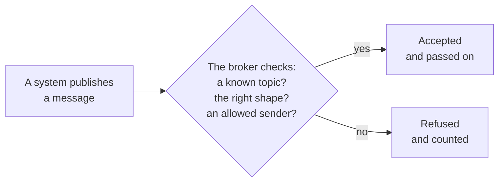
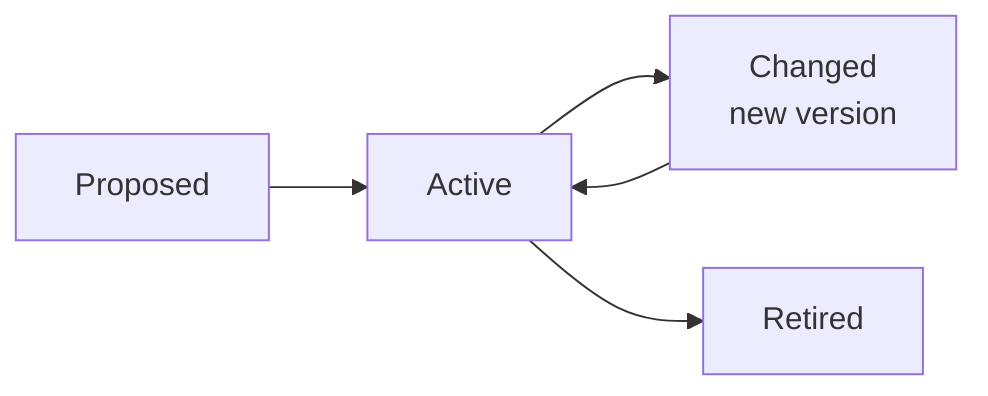

# Keeping the model honest

*Optional. About 6 minutes.*

A model is only useful while the running system follows it, and while it matches the plant. Three things keep
it that way: a broker that enforces it, a review of every change, and a regular look for drift. This page covers
the first two. Drift has [its own page](schema-drift.md).

## If it isn't in the model, the broker refuses it

A Unified Namespace has no rules of its own. Left alone, anything can be published anywhere, and a typing
mistake creates a new topic that nobody notices.

The fix is to have the broker enforce the model. Two things are generated from the model and loaded into the
broker.

| Generated from the model | What the broker does with it |
|---|---|
| **A schema for every topic** | Checks that each message has the right shape: the right fields, types and units |
| **An access list** | Lets each publisher write only to its own topics, and nothing else |

Think of the broker as a gatekeeper for meaning. A firewall refuses traffic that does not match its rules;
a governed broker refuses a message that does not match the model.

The result is that this kind of error becomes far less likely, and visible when it does happen. A bad message
is stopped early, and the count of refusals tells you something upstream needs attention.

Two things to know:

- **This is a feature of the broker, not of MQTT itself.** Not every broker can validate messages against a
  schema, so check before you choose one.
- **The rules are never typed by hand.** They are generated from the model, so they change only when the model
  changes.

## Reviewing changes

Treat the model like a drawing under document control.

1. **Propose** the change in a copy of the files, and raise the version number.
2. **Check it automatically.** Before a person looks, a program confirms the basics: every asset has a type,
   every measurement an owner, a unit and an address, every relationship two valid ends, every asset what its
   type expects, every derived value inputs that exist and no loops. A change that fails
   goes no further. Check, too, that each record's revision is still the current one.
3. **Show the impact:** what is added, removed or changed, and which topics, tags and screens are affected.
4. **Get the approval of a named role.** Saving the file is not approval. Record who approved it, when and why
   in the file itself.
5. **Try it on a test copy first.** Apply the change to a test system, or a copy of the live one, and confirm
   the tools accept it.
6. **Apply** it to the live tools in a fixed order, then confirm they all agree.

Version control (Git) gives you the history for free: who changed what, when and why.

### Version numbers

Give the model a version number, and record which version each tool is running. Agree in advance what counts
as a **breaking change**: renaming or removing something, or changing a unit, breaks whatever reads it.
Adding something new usually does not. A breaking change needs more notice, and a plan for the tools that
depend on the old form.

### Who may change what

- **Anyone** can read the model and propose a change.
- **Named roles** approve changes: one owner for each of the three files works well. Use a role or job title,
  not a person's name, so the rule survives when people move on.
- **Nobody** edits the generated files, or the configuration inside a tool, by hand.
- **Every change leaves a record.** Version control does this for the model. Check that each tool also keeps
  a log of configuration changes, and who made them.

### Choosing the overall owner

Page 2 lists [who owns each part](../2-what-a-model-looks-like.md#who-owns-what). One role still has to be
accountable for the whole. There is no single right answer, and the common candidates each have a weakness:

| Candidate | In favour | The risk |
|---|---|---|
| **Asset management** | Holds the asset register; neutral between departments; thinks in life cycles | A namespace is a live service on the control network. A maintenance hierarchy is often not the process hierarchy |
| **The automation or SCADA group** | Knows the controllers, the network and the timing; already supports operations around the clock | May model for control, not for the rest of the organisation |
| **A central data or IT group** | Strong on platforms, security and version control | Far from the plant; may not know what a value means |
| **One operating department** | Knows its own process best | Will not be seen as neutral by the others |

Some questions that help decide:

- Who is called when a value on a screen is wrong at night?
- Who can say what a measurement means, and who can say where it comes from? These are often different people.
- Whose hierarchy will the namespace follow: the maintenance one, or the process one? Write the answer down,
  and map one to the other in the bindings file.
- Who has the authority to settle a disagreement between two departments?

In a small utility one person may hold several of these roles. Keep the roles distinct anyway, so that they can
be handed over one at a time as the team grows.

### A shared core, and local additions

As more sites join, keep one small set of types that everyone shares. A site that needs something extra
**extends** a shared type; it does not alter it. A `Pump` then means the same thing everywhere, and one
site's special case stays that site's.

Use a published standard for the shared types wherever one exists.

The [wastewater example](../../examples/example-wastewater/) shows this: it uses the water example's types
unchanged and adds seven of its own, each extending a shared one. Both examples keep air apart from the process stream: a
blower or compressor *supplies air*, and only water or sewage is *fed* from one position to the next.

### The life of a model entry

Every type, asset and measurement goes through the same stages.

- **Retire, do not delete.** When a pump is removed, mark its entry as retired and record the date. Its
  history can then still be found and understood.
- **Review the whole model on a schedule,** once a year for example, even if nothing seems wrong. Remove what
  is no longer used, and check that owners are still the right roles.
- **Decide how long things are kept.** History, records and old versions of the model each need a retention
  period, and someone with the authority to set it.

Next: [Schema drift](schema-drift.md).
