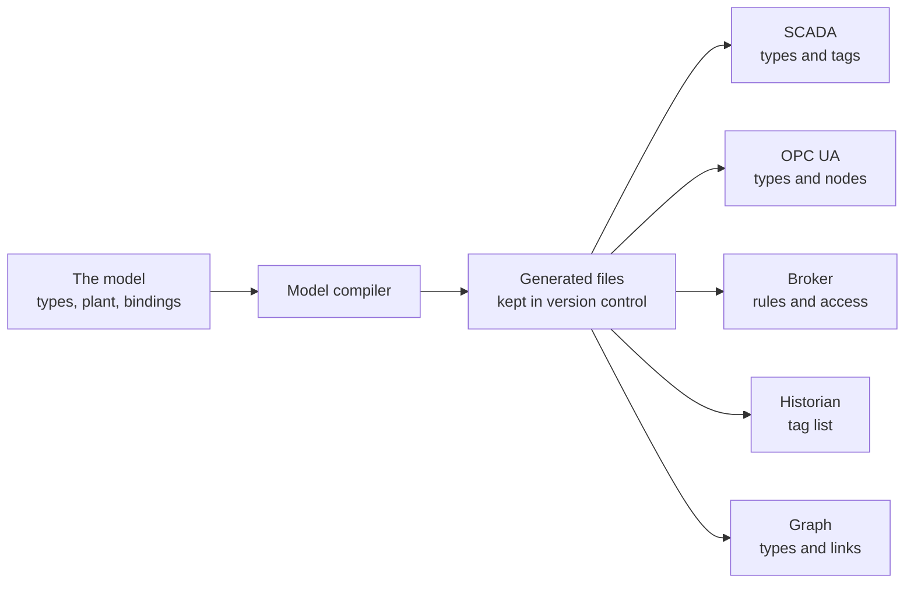

# One value, followed through

*Optional. About 8 minutes.*

The central idea of this repository is "one model, many outputs". This page shows it for a single value: the
pressure in Main A, from the [example model](../../examples/example-plant/).

## Read this first: what has been tested

**This page is an illustration, not a tested integration.** The excerpts are written by hand, shaped like the
files a model compiler would write, and trimmed to fit. Nothing here is produced by a tool in this repository.

| Output | Read by | Status |
|---|---|---|
| A topic, a message and its rules (sections 2 to 4) | A broker that validates messages | **Checked:** the sample message passes the schema, and the bad one fails |
| An OPC UA node (section 5) | An OPC UA server, or a tool that imports OPC UA types | **Checked** against the published NodeSet schema |
| A historian tag (section 6) | A historian | Illustration only |

Before you rely on any format here, import a small sample into your own tool and check the result.

## The flow



Three points about governance:

- **People edit the model, never the generated files.** A change is reviewed once, in the model.
- **The generated files are kept in version control too.** A reviewer can then see exactly what will change
  in each tool before it is applied.
- **Each tool imports its own file.** No tool is the master. If a product also lets you author a namespace
  inside it, decide first which one is the source, and let the other follow.


## 1. The model entry

Everything starts here. The value is described once in the plant file: one owner, one type, one unit.

```yaml
# 2-plant.yaml
MAIN_A_PRESSURE: {asset: MAIN_A, type: Pressure, unit: kPa}
```

Its address in each system is written once in the bindings file.

```yaml
# 3-bindings.yaml
MAIN_A_PRESSURE:
  opcua:     {identifier: TxA.MainA.Pressure}
  historian: {tag: TX_A.MAIN_A.PRESSURE}
  mqtt:      {topic: example/telemetry/water/TX_A/MAINS_A/MAIN_A/PRESSURE}
```

Everything below is worked out from those two entries.

## 2. The topic

Where the value is published in the Unified Namespace. It reads as a path: network, area, equipment, value.

```text
example/telemetry/water/TX_A/MAINS_A/MAIN_A/PRESSURE
```

## 3. A message

What is actually sent each time the pressure is reported.

```json
{
  "asset": "MAIN_A",
  "measurement": "PRESSURE",
  "value": 612.4,
  "unit": "kPa",
  "timestamp": "2026-10-09T14:05:00Z",
  "quality": "GOOD"
}
```

The message carries its own unit, the time the value was measured, and whether the value can be trusted.

## 4. The rules for a message

A JSON Schema is a list of rules a message must pass. This one is generated from the model entry: the asset,
the measurement name and the unit are fixed, and the value must be a number.

```json
{
  "$schema": "https://json-schema.org/draft/2020-12/schema",
  "title": "MAIN_A_PRESSURE",
  "type": "object",
  "required": ["asset", "measurement", "value", "unit", "timestamp", "quality"],
  "additionalProperties": false,
  "properties": {
    "asset":       {"const": "MAIN_A"},
    "measurement": {"const": "PRESSURE"},
    "value":       {"type": "number"},
    "unit":        {"const": "kPa"},
    "timestamp":   {"type": "string", "format": "date-time"},
    "quality":     {"enum": ["GOOD", "UNCERTAIN", "BAD"]}
  }
}
```

The broker holds these rules. A message that breaks them is refused. For example, this one fails twice: the
value is text, not a number, and the unit is not the one the model declares.

```json
{ "asset": "MAIN_A", "measurement": "PRESSURE", "value": "612.4", "unit": "psi",
  "timestamp": "2026-10-09T14:05:00Z", "quality": "GOOD" }
```

That is how a wrong unit is caught at the moment it is sent, instead of months later in a report
([more on this](keeping-the-model-honest.md)).

## 5. The OPC UA node

The same value as a controller or SCADA system would expose it. OPC UA describes equipment in a file called a
NodeSet. This is the part of it for one value.

```xml
<UAVariable NodeId="ns=1;s=TxA.MainA.Pressure" BrowseName="1:PRESSURE"
            ParentNodeId="ns=1;s=Asset.MAIN_A" DataType="Double">
  <DisplayName>Main A pressure</DisplayName>
  <References>
    <Reference ReferenceType="HasComponent" IsForward="false">ns=1;s=Asset.MAIN_A</Reference>
    <Reference ReferenceType="HasTypeDefinition">i=63</Reference>
  </References>
</UAVariable>
```

You would never write this by hand. The point is that the identifier, `TxA.MainA.Pressure`, is the one the
model entry gave, and the node belongs to `MAIN_A` because the model says so.

## 6. The historian tag

The name the value is stored under, so its history can be found later.

```text
TX_A.MAIN_A.PRESSURE
```

## Standards your outputs can follow

How you write a model is your choice. There is no single standard way, and the layout used here is this
repository's own. Some teams write the model directly in a standard instead, as an OPC UA information model
for example. That is equally valid.

What you generate is different. Other tools read those files, so they should follow a recognised standard
wherever one exists. Two of the outputs on this page do:

| Output | The standard it follows | Maintained by |
|---|---|---|
| The OPC UA node (section 5) | [OPC UA NodeSet](https://github.com/OPCFoundation/UA-Nodeset), the file format for OPC UA information models | The OPC Foundation |
| The rules for a message (section 4) | [JSON Schema](https://json-schema.org/) | The JSON Schema project |

The topic name and the historian tag follow a site, area, equipment convention, not a formal standard. Formal
options exist for topics and messages: [Sparkplug](https://sparkplug.eclipse.org/) defines a topic structure,
and OPC UA defines a way to publish over MQTT (OPC UA PubSub). Whether to use one is a question for the people
who build your system.

Other standards the same model could be exported to, not shown here:
[SM Profiles](https://www.cesmii.org/technology-sm-profiles/),
the [Asset Administration Shell](https://github.com/admin-shell-io/aas-specs) and
[Smart Data Models for water](https://github.com/smart-data-models/dataModel.WaterDistributionManagementEPANET).
Before you invent a type, check whether a published standard already defines it
([where to look](references.md#where-to-find-ready-made-types)).

The example's types and relationship rules are also a small ontology. As a test, they were converted to the
standard ontology format (OWL) and checked there, with no redesign needed. That export is not included here.

## How the three files line up with an open API

An open API such as i3X ([page 3](../3-an-open-api.md)) has its own words for the same ideas. The example was
laid out so that each part has a direct counterpart:

| In the three files | In i3X |
|---|---|
| `namespace` in `1-types.yaml` | A namespace: the unique address that scopes types |
| A type, with its `displayName` | An object type |
| `extends` | Inheritance between object types |
| What a type `expects` | The start of the type's schema: i3X requires a JSON Schema for every type |
| A relationship type and its `inverse` | A relationship type and its required reverse |
| An asset and its `parent` | An object, its parent, and the standard parent and child relationships |
| A measurement belonging to an asset | A component of that object |
| A relationship in `2-plant.yaml` | A relationship between two objects |
| Value, quality and timestamp in a message | The same three, returned for every value |
| The historian tag in `3-bindings.yaml` | Where a history request is answered from |

Two differences to know about:

- **The example does not include a full schema for each type.** A tool that serves i3X would have to generate
  one from the model.
- **Quality words differ slightly.** The example message uses GOOD, UNCERTAIN and BAD; i3X uses Good,
  Uncertain, Bad and one more, GoodNoData: the connection is good but no data exists.

This mapping was checked against the i3X 1.0 implementation guide in October 2026. No i3X server was built
from the example.

## Products, as examples only

These are examples as of October 2026, not recommendations, and not a complete list. None was configured from
the excerpts on this page.

- **OPC UA types:** HighByte Intelligence Hub is one product that imports OPC UA types (NodeSets) as models,
  since version 4.3.
- **Broker rules:** EMQX is one broker that can validate messages against a schema.
- **Graph types:** Timebase Atlas, in public beta, is one modelling tool that holds types and relationships.
- **An open API over OPC UA:** [i3x2ua](https://github.com/AndreasHeine/i3x2ua) is one open-source project
  that puts an i3X 1.0 interface in front of an OPC UA server you already have. It can also offer the same
  data to an AI assistant through MCP, with no write routes. Four things to know before trying it: its licence is
  AGPL-3.0; it has no sign-in of its own and expects a gateway in front to provide one; its author
  reports i3X compliance and publishes a conformance report; and writing values and MCP are both off until you turn them
  on. Some commercial products also offer i3X.

Two of these also include an assistant that helps build types:

- **Timebase Atlas** (public beta) lets you import a published standard, such as ISA-95, into your model.
  Its AI harness, Gage, uses agents to help build and query the model.
- **HighByte Intelligence Hub 4.5** includes a Modeling Agent that works with a language-model service you
  choose. It creates and edits inputs, models and instances from a plain-language request, and a person
  reviews and approves each change before it takes effect.

The same rule applies to both: start from a standard where one exists, and review everything the assistant
proposes.

## What to take from this

- **Nothing was typed twice.** The topic, the rules, the OPC UA node and the tag all come from the model.
- **One change, many files.** Change the unit in the model and every output follows.
- **Test each import early.** A tool may not accept a file the way you expect. Find that out with one asset,
  not with a thousand.

Next: [Keeping the model honest](keeping-the-model-honest.md).
