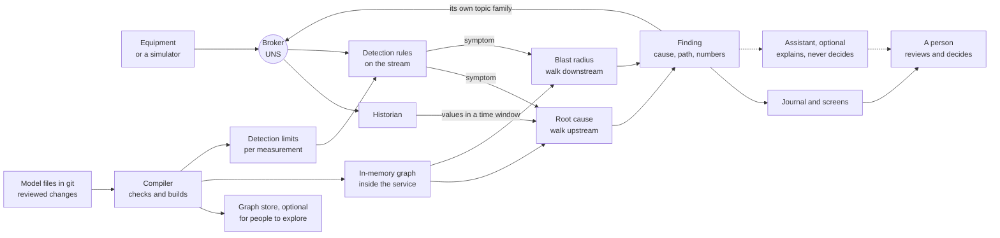

# Root cause and anomaly detection, without guessing

*Optional. About 8 minutes. For the engineer or integrator who builds it, and whoever judges what they built.*

[An incident, followed through the graph](an-incident-followed-through.md) showed **what** a model-based finding
looks like. This page shows **how** one is produced: the parts, where they run, three ways to build them, and
the open-source and commercial options for each part.

Everything here is deterministic. There is no AI in the finding. The same data and the same model always give
the same answer, and every answer carries the path and the numbers that produced it.

## Two jobs, one graph

| Job | The question | What it uses |
|---|---|---|
| **Anomaly detection** | "Is this value, or this state, abnormal right now?" | Fixed rules on the live data, with limits taken from the model |
| **Root cause** | "What upstream could have caused this?" | The model's relationships, followed **upstream**, and the history in a time window |
| **Blast radius** | "What downstream will feel this, and how soon?" | The same relationships, followed **downstream** |

Detection raises a **symptom**. Root cause walks back from the symptom to find what started it. Blast radius
walks forward from it to warn whoever is next in line. The last two are the same graph read in opposite
directions.

## The architecture



Four things to notice:

1. **The model files are the source of truth.** The graph store, the in-memory graph and the detection limits
   are all built from them, so none can drift from the others. This is the [one rule](choosing-tools.md#the-one-rule).
2. **The analysis works on an in-memory copy of the graph.** Walking a few hundred relationships in memory is
   quick, and there is no query service to fail mid-incident. A graph store is for people who want to explore.
3. **Findings go back to the broker on their own topic family**, like any [derived value](trusting-the-data.md#derived-data-values-calculated-from-other-values),
   and are kept in an append-only journal, so a review months later sees exactly what was said and why.
4. **The assistant sits outside the evidence path.** The dotted lines mean it reads the finding, and never
   feeds anything back into it.

## Detection: rules a person can read

Start with the checks on [Trusting the data](trusting-the-data.md#data-quality-is-this-value-believable): range,
stale, flatline, rate of change and source status. Those catch bad *data*. Detecting an abnormal *process* adds
a few more:

| Rule | What it catches | Note |
|---|---|---|
| **Fixed limit with a deadband** | A value past an operating limit | The deadband stops a value hovering at the limit from alarming over and over |
| **State-aware limit** | A value that is only wrong in some states | A zero flow is normal when the pump is stopped, and abnormal when it is running |
| **Change of state** | A pump stops, a protection becomes unavailable, a main is isolated | Often the most useful symptom of all |
| **Moving average against a baseline (EWMA)** | A slow drift that never crosses a fixed limit | [NIST: EWMA control charts](https://www.itl.nist.gov/div898/handbook/pmc/section3/pmc324.htm) |
| **Cumulative sum (CUSUM)** | A small, steady shift in the average | [NIST: CUSUM control charts](https://www.itl.nist.gov/div898/handbook/pmc/section3/pmc323.htm) |

Begin with the first three. They are easy to explain to an operator, and many incidents announce themselves
with a change of state. Add the statistical rules once you trust the simpler ones.

Every limit lives in the model, next to the measurement it applies to, with the person who agreed it. A rule
that fires reports the value, the limit, the time and the rule's name. That is what makes it deterministic.

## Root cause: walking upstream

The model says which relationships can carry a fault. In [the water example](../../examples/example-plant/2-plant.yaml),
*feeds*, *supplies*, *supplies air to* and *protects* can. *Shown on* and *governed by* cannot: a drawing does not
cause a pump to trip. Choosing that list is an engineering decision, and it belongs in the model's review.

The sketch below builds the graph from the example's plant file and finds every upstream asset that had an
abnormal event in the look-back window, earliest first. It is illustrative, written for this page, and
released under the [examples' MIT licence](../../examples/LICENSE). It uses
[NetworkX](https://networkx.org/), an open-source graph library for Python.

```python
import networkx as nx
import yaml

# Which relationship types can carry a fault. An engineering decision, reviewed with the model.
CAUSAL = {"Feeds", "Supplies", "SuppliesAir", "Protects"}

def load_graph(plant_file):
    """Build the graph from the model file. Rebuilt at every start, never edited by hand."""
    with open(plant_file) as f:
        plant = yaml.safe_load(f)
    g = nx.MultiDiGraph()  # allows two different relationships between the same pair of assets
    for rel in plant["relationships"]:
        if rel["type"] in CAUSAL:
            g.add_edge(rel["source"], rel["target"], type=rel["type"])
    return g

def candidate_causes(g, symptom, abnormal, since):
    """Upstream assets with an abnormal event since `since`, earliest first, each with its path."""
    found = []
    for asset in nx.ancestors(g, symptom):
        event = abnormal.get(asset)  # the earliest abnormal event per asset, read from the history
        if event and event["time"] >= since:
            found.append({"cause": asset, "event": event,
                          "path": nx.shortest_path(g, asset, symptom)})
    # Sort by time, then by name, so a tie always comes out in the same order.
    return sorted(found, key=lambda f: (f["event"]["time"], f["cause"]))
```

Run against the example with the invented incident's events, the symptom *Main A isolated* gives four
candidates. The earliest is the compressor, by the path *compressor → surge vessel → Main A*. The turbidity alarm
and the pump stop come later, on the other path *filter → clearwell → pump → Main A*. A good finding names both:
the pump stop **triggered** the surge, and the compressor fault **removed the protection** against it.

The finding then adds the timing between each step, from the stored history, and suppresses the downstream
alarms, each with the relationship that justifies hiding it.

## Blast radius: walking downstream

The same graph, read forwards, says who is affected next:

```python
def blast_radius(g, asset):
    """Everything downstream of `asset` along a causal relationship."""
    return sorted(nx.descendants(g, asset))
```

In the example, a problem at the surge vessel reaches Main A, Reservoir A and Zone A. If the model carries a
travel or response time on each relationship (the example does not), a weighted shortest-path search gives the
earliest each one could be affected, which turns the list into an early warning.

## Three ways to build it

All three keep the model in files and the analysis on an in-memory graph. They differ in what else holds it.

1. **Files and an in-memory graph.** The compiler checks the model; the analysis service loads it into a graph
   library at start-up. Nothing else to run: the [graph-library option](graph-database.md), and a good first step.
2. **An open-source graph database beside it.** The compiler also loads a graph database, so engineers can ask
   their own questions of the model. The database is rebuilt from the files, never edited directly.
3. **A commercial graph or asset platform beside it.** A product holds the model with screens, access control,
   connectors and often an assistant. The analysis still loads its own copy, from the files or from the
   product's export. If your team edits the model in the product, its export must be committed and reviewed like
   any other change, or the files are no longer the source of truth.

For pattern 2 in [TypeDB](https://typedb.com/docs/), the same upstream search can be written in the database's
own query language. TypeDB 3 does this with [*functions*](https://typedb.com/docs/typeql-reference/functions/functions-vs-rules/),
which replaced the *rules* of earlier versions; examples written for older versions will not run on it.

## Open source or commercial: a comparison

| | Open source (patterns 1 and 2) | Commercial (pattern 3) |
|---|---|---|
| **Who maintains it** | You, or an integrator you hire. The project's community fixes the library | The vendor maintains the product; you maintain the model and the rules |
| **Skills needed** | Python or similar, Git, and someone who understands graphs | The product's own training; less programming, more configuration |
| **Governance and versions** | Git gives review, history and rollback | Depends on the product. Some keep every change as a version; check that you can see who changed what |
| **Auditability** | Every line of the analysis can be read. You must build the journal | Often a built-in audit trail; the analysis inside it may be harder to inspect |
| **Scale** | Ample for models the size of the examples here; measure it at your own size. A database adds room to grow | Built for many users and large models; ask to see it at your size |
| **Support** | Community forums, or a support contract from a third party | A vendor contract with a named term |
| **Lock-in and exit** | Low: the files are yours and the libraries are interchangeable with some rework | Varies. Test a full export and a rebuild from it before you depend on it |
| **Licence model** | Open-source licences (BSD, Apache, MPL, GPL); read each one's obligations | A commercial agreement; the vendor's terms govern |

Neither column is better. A small team with one Python-literate engineer can go a long way with the first. A team
that wants screens, support and access control, and has no programmer, may be better served by the second. Some
end up with both: a commercial platform for people, and a small open-source service for the finding of record.

## Products by role

Examples as of October 2026, not recommendations, and not a complete list. None was tested for this page.

| Role | Open source | Commercial |
|---|---|---|
| **In-memory graph library** | [NetworkX](https://networkx.org/) (BSD-3-Clause); [rustworkx](https://www.rustworkx.org/) (Apache-2.0), built for speed, with a different API: see its [guide for NetworkX users](https://www.rustworkx.org/networkx.html) | Rarely needed: the libraries are the usual choice |
| **Graph database** | [TypeDB](https://github.com/typedb/typedb) Community Edition (MPL-2.0); [Neo4j](https://neo4j.com/licensing/) Community Edition (GPLv3) | Neo4j Enterprise Edition; [Timebase Atlas](https://hub.docker.com/r/timebase/atlas), a knowledge model for industrial data with Cypher queries, a REST API and i3X |
| **Asset model with built-in analytics** | Usually assembled from the parts on this page | [AVEVA PI Asset Framework](https://docs.aveva.com/bundle/pi-server-f-af-pse/page/1021923.html), whose asset analytics can create *event frames* (records of an event with a start, an end and the assets involved) |
| **Detection rules on the stream** | [eKuiper](https://github.com/lf-edge/ekuiper) (Apache-2.0), SQL rules over MQTT for the edge; [Apache Flink](https://flink.apache.org/) (Apache-2.0), for large streams | The analytics built into your historian or data platform |

For an assistant that helps *build* the model, see [the one-value page](one-value-followed-through.md#products-as-examples-only). It plays
no part in the finding.

## Pitfalls

- **Loops in the plant.** Recirculation and recycle lines make cycles in the graph. Library functions like
  `ancestors` and `descendants` keep a list of what they have visited, so they finish; a search you write
  yourself must do the same. A cycle also means "upstream" can include the symptom's own outputs, so the
  timing has to decide what came first.
- **Missing starting states.** Many systems send a value only when it changes. If the analysis starts after a
  pump stopped, it never saw the stop. Read the last known state of every event from the history at start-up.
- **A stale graph.** If a main is valved out or a pump is retired and the model is not updated, the walk follows
  a path that no longer exists. Catch it with the [drift checks](schema-drift.md).
- **The wrong time window.** Too short and the root cause is missed (in the example, the first sign was a work
  order two weeks before the break). Too long and unrelated events crowd in. Set the window per kind of
  investigation, in the model, and show it in the finding.
- **One incident at a time.** A look-back assumes one incident. Two overlapping ones can borrow each other's
  events. Say so in the finding when candidates come from more than one chain.
- **Alarm floods.** During a flood, detection must not raise a symptom for every alarm. Group alarms on the same
  path, and suppress the consequences with a recorded reason ([ISA-18.2](https://www.isa.org/standards-and-publications/isa-standards/list-of-all-isa-standards)
  covers flood management).
- **Ties.** Two events with the same timestamp must always sort the same way, or the same data gives two
  different findings. Sort by time, then by a fixed key.

## Where AI fits

The same place as on the [incident page](an-incident-followed-through.md#where-ai-fits): **after** the finding,
never in it. An assistant can read the finding and explain it in plain words. It must say it is explaining;
its words are never evidence, never published as a finding and never fed back into the analysis. A person decides.

## References

Checked in October 2026. NetworkX [documentation](https://networkx.org/documentation/stable/) (BSD-3-Clause);
rustworkx [for NetworkX users](https://www.rustworkx.org/networkx.html); TypeDB [repository and licence](https://github.com/typedb/typedb)
and [functions vs rules](https://typedb.com/docs/typeql-reference/functions/functions-vs-rules/); Neo4j [licensing](https://neo4j.com/licensing/);
Timebase Atlas [description](https://hub.docker.com/r/timebase/atlas); AVEVA PI Server [event frames](https://docs.aveva.com/bundle/pi-server-f-af-pse/page/1021923.html);
[eKuiper](https://github.com/lf-edge/ekuiper); [Apache Flink](https://flink.apache.org/); the NIST/SEMATECH e-Handbook of Statistical
Methods on [EWMA](https://www.itl.nist.gov/div898/handbook/pmc/section3/pmc324.htm) and [CUSUM](https://www.itl.nist.gov/div898/handbook/pmc/section3/pmc323.htm).

Next: [One value, followed through](one-value-followed-through.md).
