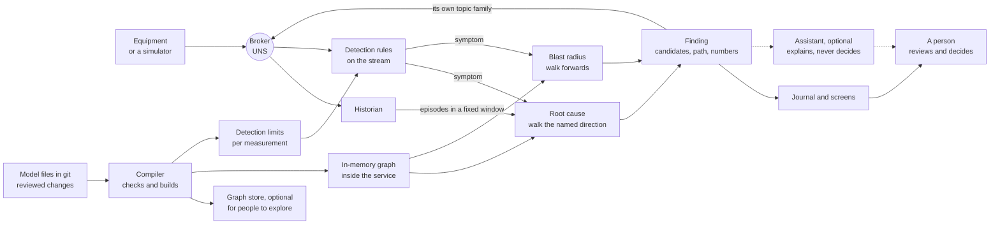

# Root cause and anomaly detection, without guessing

*Optional. About 12 minutes. Advanced: you do not need this page to get started. For the engineer or integrator
who builds it, and whoever judges what they built.*

The [incident page](an-incident-followed-through.md) shows a finding. Here is how to build one with fixed rules,
history and a reviewed graph. Findings carry their paths and supporting values.

## Three jobs, one graph

| Job | The question | What it uses |
|---|---|---|
| **Anomaly detection** | "Is this value, or this state, abnormal right now?" | Fixed rules on the live data, with limits taken from the model |
| **Root cause** | "What, in either direction, could have caused this?" | The model's relationships, followed in the direction the investigation names, and the history in a time window |
| **Blast radius** | "What may be affected under this propagation assumption?" | Forward reachability; timing only with reviewed delay assumptions |

Detection raises a **symptom**. Root cause looks for what started it. Blast radius lists potentially affected assets.

## Which way to walk

On this page, **downstream** means following the relationship arrows as they are written in the model, from
source to target. **Upstream** means following them backwards. The cause is not always upstream. The sewage
pumps are downstream of the wet well, yet when they fail, the effect shows upstream, as a rising level.

Some examples, not a complete set of rules:

| Symptom | Where to look |
|---|---|
| A main isolated, loss of supply | Upstream: something that feeds or protects it failed |
| Low pressure | Upstream, for a failed supply. Downstream too: excess demand, or a leak |
| High level, backing up, an overflow | Downstream: what should take the flow away failed. Upstream too: too much coming in |

So each kind of investigation names its direction, or both, and the model can only answer the directions it
represents.

## The architecture



Build the graph and limits from the same reviewed model version ([one rule](choosing-tools.md#the-one-rule));
confirm every tool loaded it. Analysis walks its in-memory copy. Publish findings on their own
[topic family](trusting-the-data.md#derived-data-values-calculated-from-other-values) and retain an append-only
journal. An [assistant](an-incident-followed-through.md#where-ai-fits) may explain findings, labelled as
explanation; its words are never evidence or analysis input. A person decides.

## Detection: rules a person can read

Start with the checks on [Trusting the data](trusting-the-data.md#data-quality-is-this-value-believable): range,
stale, flatline, rate of change and source status. Those catch bad *data*. Detecting an abnormal *process* adds
a few more:

| Rule | Use |
|---|---|
| **Fixed limit with deadband** | Operating limit; deadband prevents repeated alarms near it |
| **State-aware limit** | Zero flow is normal when stopped, abnormal when running |
| **State change** | Unexpected stop, lost protection, isolation |
| **Exponentially weighted moving average (EWMA)** | Slow drift ([NIST](https://www.itl.nist.gov/div898/handbook/pmc/section3/pmc324.htm)) |
| **Cumulative sum (CUSUM)** | Small sustained mean shift ([NIST](https://www.itl.nist.gov/div898/handbook/pmc/section3/pmc323.htm)) |

Begin with the first three: they are easy to explain. Add the statistical rules once you trust
them. A statistical baseline must suit the operating state and the sampling: normal pump cycling and a planned
stop are not faults.

Every limit lives in the model, next to the measurement it applies to, with the role that agreed it. A rule
that fires reports the value, the limit, the time and the rule's name, which makes the result auditable. Getting
the same result every time also needs fixed rules, configuration, starting state and inputs.
The example models carry quality limits only (the believable range, and how long before a value is stale or
stuck); operating and alarm limits would be added the same way.

## Root cause: walking the graph

The model says which relationships can carry a fault. In [the water example](../../examples/example-plant/2-plant.yaml),
*feeds*, *supplies*, *supplies air to* and *protects* can. *Part of*, *installed at*, *monitors*, *governed by*, *shown
on* and *concerns* cannot: they describe where something sits, what observes it or what is written about it,
and a drawing does not cause a pump to trip. Choosing that list is an engineering decision, and it belongs in the model's review.

The sketch below builds the graph from a plant file and lists the assets in one direction that were abnormal
during a fixed window, earliest first. It uses [NetworkX](https://networkx.org/documentation/stable/), an open-source graph library
for Python, and is covered by this page's CC BY 4.0 licence, like the rest of the page.

```python
import networkx as nx
import yaml

# Shorthand for this page. In an implementation this would be reviewed metadata on each relationship type in
# 1-types.yaml, supplied by the compiler. The example files carry no such metadata today.
CAUSAL = {"Feeds", "Supplies", "SuppliesAir", "Protects"}

def load_graph(plant_file):
    """Build the graph from the model file. Rebuilt at every start, never edited by hand."""
    with open(plant_file) as f:
        plant = yaml.safe_load(f)
    g = nx.MultiDiGraph()  # allows two different relationships between the same pair of assets
    g.add_nodes_from(plant["assets"])  # every declared asset, even one with no causal relationship
    for rel in plant["relationships"]:
        if rel["type"] in CAUSAL:
            g.add_edge(rel["source"], rel["target"], type=rel["type"])
    return g

def candidate_causes(g, asset, episodes, window, direction):
    """Assets to investigate, not established causes, earliest first.

    `asset` owns the symptom (WET_WELL, not WET_WELL_HIGH_LEVEL). `episodes` maps an asset to its abnormal
    episodes, prepared from the history for this window: {"event", "onset", "cleared"}, UTC datetimes,
    "cleared" None while still abnormal. `window` is (start, end); end is the symptom's time.
    """
    if direction == "upstream":
        others = nx.ancestors(g, asset)
    elif direction == "downstream":
        others = nx.descendants(g, asset)
    else:
        raise ValueError(f"direction must be 'upstream' or 'downstream', not {direction!r}")
    start, end = window
    found = []
    for other in others:
        for ep in episodes.get(other, []):
            # Overlaps the window: began by its end, and had not cleared before its start.
            if ep["onset"] <= end and (ep["cleared"] is None or ep["cleared"] >= start):
                path = (nx.shortest_path(g, other, asset) if direction == "upstream"
                        else nx.shortest_path(g, asset, other))
                found.append({"candidate": other, "episode": ep, "path": path})
    # Sort by time, then by fixed keys, so a tie always comes out in the same order.
    return sorted(found, key=lambda f: (f["episode"]["onset"], f["candidate"], f["episode"]["event"]))
```

**What the sketch assumes.** The caller resolves an alarm to the asset that owns it. `ancestors` and
`descendants` leave out that asset, so checking it for a local failure is a separate step. Both directions means
two calls, then removing duplicates. `episodes` was read from the history for a fixed window: it includes states
already abnormal when the window opened, keeps repeat faults as separate episodes, each with its recovery time, and
uses comparable UTC times. The window's end is a hard cut-off: nothing after the symptom is offered as its cause.

**What the path means.** `shortest_path` returns one shortest list of names: an illustrative connectivity path,
not the route the fault took. It drops which relationship each step used (the wastewater screen both *feeds* and
*protects* the grit chamber). A finding keeps the typed relationships it relies on, with evidence for each. A
downstream path runs in relationship order, symptom to candidate; that arrow does not claim the symptom caused it.

### Run against both examples

The sketches were run in October 2026 with NetworkX 3.6.1, PyYAML 6.0.3 and Python 3.12.3, on these invented
events (one day, UTC):

| Example, symptom, window, direction | Episodes given | Result, earliest first |
|---|---|---|
| Water: Main A isolated at 06:15; 06:00–06:15; upstream | Compressor fail-to-start 05:40, still active; surge protection unavailable 05:41, still active; filter 1 high turbidity 06:08; high-lift pump 2 tripped 05:30, cleared 05:35, stopped again 06:12; pump 1 stopped 06:12; filter 2 high turbidity 06:30 | Compressor, surge vessel, filter 1, pump 1, pump 2 (its 06:12 stop). Not pump 2's 05:30 trip (cleared before the window) or filter 2 (after the cut-off) |
| Wastewater: wet well high level at 03:20; 03:00–03:20; downstream | Sewage pump 1 tripped 03:05; pump 2 fail-to-start 03:06; forcemain low pressure 03:07 | Pump 1, pump 2, forcemain |
| Wastewater: the same, upstream | The same | None: nothing feeds the wet well in the model |

Also checked: `direction="sideways"` raises an error, and filter 1's turbidimeter, which has only a *monitors*
relationship, returns no candidates instead of an error.

### Candidates are not causes

Reachability and order in time say what to investigate, not what caused it. The forcemain's low pressure is a
candidate, yet it is a consequence of the pumps stopping. Confirming a cause needs a plausible failure
mechanism, operating states in which it could act, trustworthy measurements, timing consistent with it, and
review by an operator or engineer. "Insufficient evidence" is an acceptable answer.

In the water result, a good finding separates roles: the pump stop **triggered** the surge, and the compressor
fault **removed the protection** against it, a contributing condition. In the wastewater example, too much
inflow cannot be found at all: no inflow source is modelled.

The service then **groups** related findings into one incident, with the timing between steps, and keeps every
underlying event. Grouping is not suppression. A relationship alone never justifies hiding an alarm that needs
its own response, such as a wet well high-high level. Real suppression is designed conditional alarm logic, with
approved conditions, rules for applying and releasing it, and an audit trail, inside an alarm-management process
(designed suppression, in the terms of [ISA-18.2](references.md#where-to-find-ready-made-types) and IEC 62682;
[ISA, on managing and optimising alarms](https://www.isa.org/intech-home/2017/september-october/features/from-managing-to-optimizing-alarms)).

## Blast radius: walking forwards

The same graph, read forwards, gives one example of who may be affected next:

```python
def blast_radius(g, asset):
    """Everything reachable forwards from `asset` along a causal relationship."""
    return sorted(nx.descendants(g, asset))
```

In the water example, a problem at the surge vessel reaches Main A, Reservoir A and Zone A: what is
**potentially** affected, if effects travel with the arrows. It is not complete: `blast_radius(g, "SP_01")` in
the wastewater example omits the wet well that fills when the pump stops. With a reviewed travel time on each
relationship (the examples have none), a weighted shortest-path search estimates the earliest each could be
affected, valid only while those delays add up as assumed.

## Three ways to build it

1. **Files and an in-memory graph library**, rebuilt from the model at every start.
2. **Files and a graph database**, loaded from the model.
3. **Files and an asset platform** that holds the model alongside the data.

Start with the first. Add a graph database or asset platform when people need exploration, screens or access
control ([options](graph-database.md)). All patterns derive from reviewed files; product edits
must return through a committed, reviewed export before rebuilding.

All three patterns need an analysis service unless a product demonstrates the required causal analysis.
Commercial tools may reduce configuration and screen-building work; you still own the model and rules. Test a
full export and rebuild. For maintenance, audit and licence checks, see [Build or buy?](build-or-buy.md) and
[Choosing tools](choosing-tools.md#fifteen-questions-to-ask).

## Products by role

Product examples checked October 2026; not recommendations or product evaluations. Commercial licences: the
vendor's terms govern.

| Role | Open source | Commercial |
|---|---|---|
| **In-memory graph library** | [NetworkX](https://networkx.org/) (BSD-3-Clause); [rustworkx](https://www.rustworkx.org/) (Apache-2.0), with a [different API](https://www.rustworkx.org/networkx.html); benchmark your workload | Rarely needed |
| **Graph database** | [TypeDB](https://github.com/typedb/typedb) Community Edition (MPL-2.0); TypeDB 3 uses [*functions*](https://typedb.com/docs/typeql-reference/functions/functions-vs-rules/) instead of rules. [Neo4j](https://neo4j.com/licensing/) Community Edition (GPLv3) | Neo4j Enterprise Edition; [Timebase Atlas](https://hub.docker.com/r/timebase/atlas) (public beta), which holds an industrial model as a graph, with Cypher queries, a REST API and i3X |
| **Asset model with built-in analytics** | Usually assembled from the parts on this page | [AVEVA PI Asset Framework](https://docs.aveva.com/bundle/pi-server-f-af-pse/page/1021923.html): analytics create event frames (event interval and involved assets). [Canary](https://helpcenter.canarylabs.com/t/m1ypq4h/calcs-events): asset models (Views), with a calculation service that creates events per asset |
| **Detection rules on the stream** | [eKuiper](https://github.com/lf-edge/ekuiper) (Apache-2.0), SQL rules over MQTT for the edge; [Apache Flink](https://flink.apache.org/) (Apache-2.0), for large streams | The analytics built into your historian or data platform |

For an assistant that helps *build* the model, see [the one-value page](one-value-followed-through.md#products-as-examples-only). It plays
no part in the finding.

## Pitfalls

- **Loops in the plant.** Recycle lines make cycles. `ancestors` and `descendants` track what they have
  visited, so they finish; a search you write must do the same. In a cycle, "upstream" can include the symptom's
  own outputs, so timing decides what came first. Each relationship family being free of loops does not make the
  combined graph free of them; the examples have none. Giving a return flow its own relationship type
  makes its meaning clear, but leaving it out of the walk leaves the causes it carries unanswerable.
- **A stale graph.** If a main is valved out and the model is not updated, the walk follows a path that no
  longer exists. Catch it with the [drift checks](schema-drift.md).
- **The wrong time window.** Choose the window per investigation and show it in the finding; preserve faults
  active at its start. Retrieve supporting records, such as work orders, separately.
- **One incident at a time.** Two overlapping incidents can borrow each other's events. Say so in the finding.

Next: [One value, followed through](one-value-followed-through.md).
