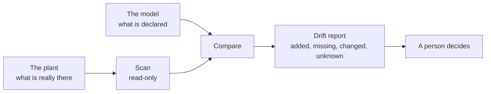

# Schema drift

*Optional. About 4 minutes.*

**Schema drift** is when the model and the real system stop matching. It comes in more than one kind.

| Kind | Example | How it is caught |
|---|---|---|
| **The plant against the model** | A transmitter is added at the controller and the model is not told | A scheduled scan and comparison (below) |
| **The namespace against the model** | A declared topic goes silent; an unknown topic appears; a publisher changes the shape of its messages | The broker's refusals, and a check for topics that have stopped updating |
| **The knowledge graph against the plant** | A main is re-piped, and the model still shows the old connection | People and records: no instrument reports it |
| **A tool against the model** | The open API still serves last month's types | Record which model version each tool is running |

## The plant against the model

Someone adds a transmitter, renames a tag or removes a pump at the controller, and the model is not told.

It is hard to see for two reasons.

- **The source usually does not announce it.** A controller or OPC UA server usually does not tell anyone that
  its tags changed, and few tools listen if it does.
- **The missing data is silent.** A tag that is not in the model is never published, so nothing downstream
  shows an error. It is simply absent.

### How to catch it

Compare the two sides on a schedule.

1. **Scan** the plant's OPC UA server, read-only, and list what is there.
2. **Compare** that list with what the model declares.
3. **Report** the differences:

| Result | Meaning |
|---|---|
| **Added** | In the plant, not in the model |
| **Missing** | In the model, not found in the plant |
| **Changed** | Found, but the name or data type is different |
| **Unknown** | The scan did not finish, so no conclusion is drawn |

4. **Decide.** A person closes each item one of three ways: update the model, put the plant back, or record an
   accepted exception with a reason.

Two rules matter more than the tooling.

- **Never adopt a change automatically.** A scan gives evidence; a person decides.
- **Never treat an incomplete scan as a removal.** "Unknown" is a valid answer.

## The namespace against the model

The broker already refuses messages that break the model's rules, and counts them. Two more things are worth
watching:

- **Silence.** A topic the model declares that has stopped updating. The "stale" check in
  [Trusting the data](trusting-the-data.md) finds it.
- **Strangers.** A topic that is being published but is not in the model. Either the model is behind, or
  something is publishing that should not be.

## The knowledge graph against the plant

This is the hardest kind, because nothing announces it. When pipework is changed, or a standby unit takes
over, the values keep arriving and every check passes. Only the relationship in the model is wrong, and the
answers that depend on it.

It is caught through people and records:

- **Tie the model to change control.** A change to the plant is not finished until the model's relationships
  have been reviewed.
- **Watch the drawings.** The model records which drawing each asset appears on, and its revision. A new
  revision is a prompt to check the relationships of everything on it.
- **Walk it down.** On a schedule, have someone who knows the plant read the relationships for one area and
  confirm them.
- **Listen to the data.** A pump that runs while the flow it is said to feed does not change is a hint that a
  relationship is wrong.

## Why a governed model makes this possible

Without a declared model there is nothing to compare against, so there is no drift, only surprises.
The model is what turns "something looks different" into a list you can work through.

No tool prevents drift for you. It is managed with discipline: a model people trust, a regular comparison, and a
review step that is quick enough that nobody is tempted to skip it.

Next: [Trusting the data](trusting-the-data.md).
