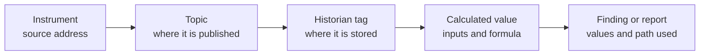

# Trusting the data

*Optional. About 5 minutes.*

A model tells software what a value means. It can also say what a believable value looks like, where a number
came from, and who may see it. Those three things decide whether people will act on the result.

## Data quality: is this value believable?

A schema check asks, "is this message the right shape?" A quality check asks, "is this value believable?"

A quality check needs something to compare against. That is why it belongs with the model: the model is where
"normal" is written down.

| Check | What it catches | Example |
|---|---|---|
| **Range** | A value outside what is physically possible | A gauge pressure of −150 kPa, below a perfect vacuum |
| **Flatline** | A value that has stopped changing | A level reading the same figure for six hours |
| **Stale** | No update within the expected time | A turbidity reading last sent yesterday |
| **Rate of change** | A jump faster than is possible | A reservoir level rising two metres in a minute |
| **Unit** | A value sent in a unit the model does not declare | A pressure sent in psi where the model says kPa |
| **Source status** | The equipment itself says the value is bad or uncertain | A transmitter reporting a fault |
| **Verification** | A reading from an instrument that is overdue for its check | A turbidimeter not verified for eight months |

In the example, each measurement type carries these expectations. The numbers are invented; operators know
what is normal for each site.

```yaml
# 1-types.yaml
Pressure: {units: [kPa], quality: {range: [0, 1600], staleAfter: 1 min, flatlineAfter: 15 min}}
```

One measurement can override its type, with a reason: see `ZONE_A_PRESSURE` in the example.

**Units deserve special care.** A wrong unit passes every shape check and still gives a wrong answer. The
model is the one place that knows both the unit an instrument reports in and the unit you publish, and the
bindings file records both. Convert once, as near the source as possible, and never convert the same value again somewhere else. Use a
published list of unit codes, so `kPa` means the same thing in every tool
([where to look](references.md#where-to-find-ready-made-types)).

Three things to keep in mind:

- **Mark, do not delete.** A value that fails a check is flagged as suspect and kept. A flat reading is
  sometimes true: a full reservoir, a stopped pump. People decide what it means.
- **Pass the status on.** If the source says a value is bad, every system downstream should still know that.
- **The rule and the fact live apart.** The model says how often an instrument must be verified. The date it
  was last done is looked up from the system that records it.

## Derived data: values calculated from other values

Some values are not measured. A service subscribes to the live data, calculates something, and publishes the
result for others to use: an average, a rate of change, a count of alarms.

Model a derived value like a measurement, and add what it is made from:

```yaml
# 2-plant.yaml
MAIN_A_PRESSURE_AVG_5MIN:
  asset: MAIN_A
  type: Pressure
  unit: kPa
  inputs: [MAIN_A_PRESSURE]
  formula: "the average of the input over a moving 5-minute window"
  publishedBy: stream-calculator
```

Three rules keep derived data trustworthy:

1. **Only the calculating service may publish it,** on its own topic family, so nobody mistakes a calculation
   for a measurement.
2. **It is only as good as its inputs.** If any input is suspect or stale, the result is marked the same way.
3. **No loops.** A derived value may never be one of its own inputs, directly or through others.

A figure reported to a regulator is a derived value too: write down its inputs and formula, so the way it was
summarised can be audited.

Keep heavy calculation out of the shared namespace, and publish only the results people need. A derived value
carries the time of the data it was worked out from, not the time it was published.

## Data lineage: where did this number come from?

Lineage is the trail from a number on a screen back to the instrument that measured it. When someone
questions a result, lineage is how you answer.

The three model files already hold most of it:



The bindings file gives the first three steps, and each derived value lists its inputs. Each model file also
carries a change record: its version, the date, the role that approved it and the reason. A result can then
be traced to the exact model it was worked out under.

A good test: pick any number in a report and ask how long it takes to trace it back to an instrument.

A utility answers to a regulator, a board and the public, and a result that cannot be explained will not be
trusted. Quality marks and lineage are what make the explanation possible.

## What may be given to an AI tool

Before any AI tool is connected, decide what it may see. A simple three-way split is enough to start:

| Class | Meaning | Example |
|---|---|---|
| **Public** | Already published | Annual water quality summaries |
| **Protected** | For internal tools only, under your organisation's control | Live process values, the model itself |
| **Off-limits** | Not given to any AI tool | Network details, security settings, personal information |

Agree, too, what staff may paste into a public AI service. The default should be nothing from the plant.

Next: [Where the history goes](where-the-history-goes.md).
