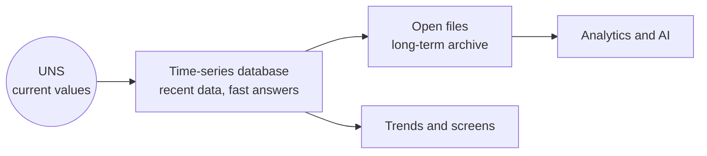

# Where the history goes

*Optional. About 3 minutes.*

A Unified Namespace holds the **current** value of everything. It does not remember. If you want to know what a
pressure was last Tuesday, something has to have stored it.

That job belongs to a historian. If you are thinking of replacing one, or adding an open copy beside it, it
helps to be clear about what a historian really does.

## A historian does more than store

| It does this | In plain words |
|---|---|
| **Stores efficiently** | Keeps years of values without filling the disk |
| **Answers in several ways** | The raw values, the value at an exact moment, or an average, minimum or maximum over a period |
| **Gives one way to ask** | Every tool uses the same request, as with OPC UA Historical Access |

The second row is the one people forget. A trend screen asks for averages over an hour. An investigation asks
for the exact values around one event. A replacement has to do both.

## Calculated values need a home too

A daily total, a run time or an efficiency figure is often worked out inside a report. Two reports then
disagree, and nobody can say which is right.

Treat a calculated value like a measurement ([how to model one](trusting-the-data.md#derived-data-values-calculated-from-other-values)): one name, one unit, one owner, a written formula and a list of
its inputs. Store the result with the history, so every tool reads the same number.

Data sometimes arrives late, or is corrected afterwards. A calculated value should then be worked out again
automatically, not left as it was first computed.

## Why keep the history in an open format

- **It is yours.** You can read it without the product that wrote it.
- **Any tool can use it.** Analytics, reporting and AI tools read open formats directly.
- **You can change products** without losing or converting years of data.

## A pattern that works: two tiers

| Tier | Good for |
|---|---|
| **Time-series database** | Recent data, quick trends, the several ways of asking |
| **Open files**, such as Parquet | Long-term archive, large analyses, an independent backup |

[Parquet](https://parquet.apache.org/) is an open file format for large tables. It stores data by column, which
makes it compact and quick to analyse.

## Why not an ordinary database?

Many SCADA systems store history in a general-purpose SQL database. It works well at first. As the tables grow,
they need care: indexes, partitioning and archiving. Without it, reading a long trend can become slow.

Time-series databases are built for this shape of data. They split it by time, compress it, and compute
averages without reading every row.

Several SCADA products now include or support a time-series database for this reason.

An established historian already does the three things in the first table. The questions below apply to it
as much as to anything new.

## Questions to ask of any replacement

1. Can I get raw values, values at a moment, and averages over a period?
2. Is the stored data in a format I can read without this product?
3. Does it offer a standard way to ask, such as OPC UA Historical Access or an [open API](../3-an-open-api.md)?
4. How does it perform with five or ten years of data, not five months?
5. Does each stored value keep its original timestamp and quality?

Next: [Moving the data](moving-the-data.md).
